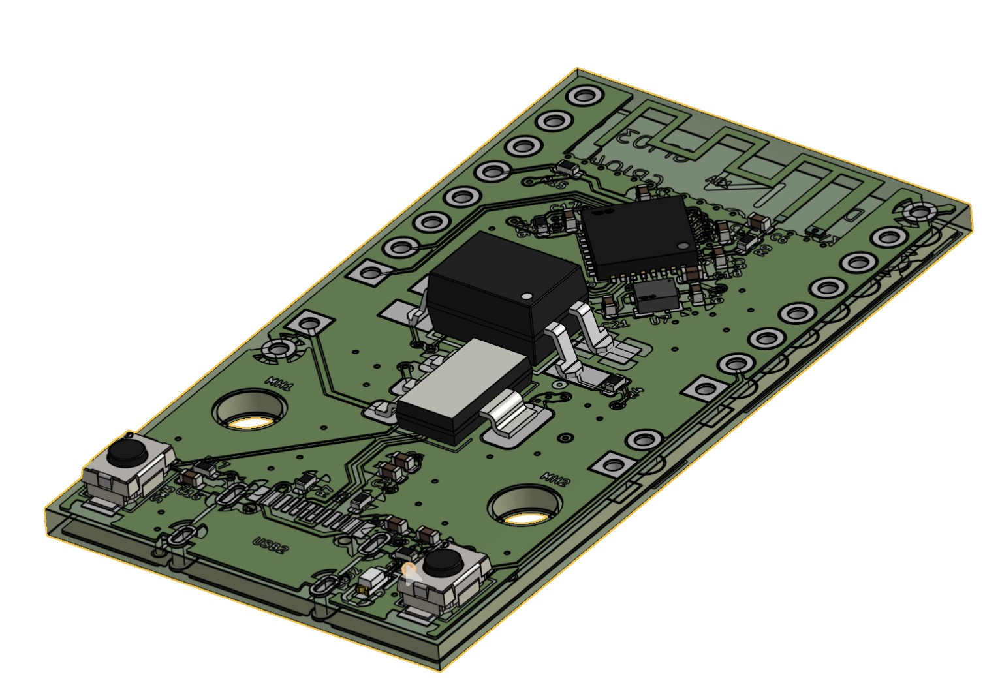

# Garage-Door-Controller

 

## What it is
An ESP32-C3 based bluetooth controller for an old B&amp;D roller door. Also works as a standard devboard. 

## Inspiration
I started this project because I had an old roller door and the remote was playing up. I prototyped it with a normal ESP32 on a breadboard, and decided to make a better version on one PCB with a case. I am both nervous and excited to get it made as I have never made a proper PCB this complicated before. 

## Parts
### Schematics
Garage-Door-Controller is essentially just a ESP32-C3 devboard, with an on-board optocoupler to short the pins of the up/down button on the roller door. Because JLCPCB has a minumum PCB assembly quantity of 2, I plan to use one as the controller, and the other as a normal devboard with an inbuilt optocoupler. 

### PCB
The PCB is designed to be as small as possible, and it is really just a standard ESP32-C3 devboard that I designed, but I added two mounting holes and two sets of pin headers which is a bit custom. 

### [Case](https://cad.onshape.com/documents/283e0c7c058a35166ead487a/w/4066f8a87f001ae32717c400/e/d57d04382974445a9a2175db)
The case is a simple 3D printed case, and I decided to make it translucent because it will look really nice. I made flexible button actuators and a screw wall hanger, and it will be screwed together with M3 bolts and heatset inserts. 

### BOM
Here is the [full BOM](https://github.com/zacianculovici/Garage-Door-Controller/blob/main/BOM.csv)
| Part                      | Type       | Quantity | Unit price aud | Line total aud | Link                                                         | Vendor                      | Funding     | Notes                             | Quantity needed | Value               | Lcsc      |
| :------------------------ | :--------- | :------- | :------------- | :------------- | :----------------------------------------------------------- | :-------------------------- | :---------- | :-------------------------------- | :-------------- | :------------------ | :-------- |
| C2,C5                     | Part       | 20       | 0.029          | 0.58           | https://jlcpcb.com/parts/componentSearch?searchTxt=C15525    | JLCPCB                      | Grant       |                                   | 2               | 10uF                | C15525    |
| SW1,SW3                   | Part       | 14       | 0.0761         | 1.0654         | https://jlcpcb.com/parts/componentSearch?searchTxt=C720477   | JLCPCB                      | Grant       |                                   | 2               | BOOT,RST            | C720477   |
| C19,C21                   | Part       | 20       | 0.0037         | 0.074          | https://jlcpcb.com/parts/componentSearch?searchTxt=C1547     | JLCPCB                      | Grant       |                                   | 2               | 12pF                | C1547     |
| R8                        | Part       | 20       | 0.0016         | 0.032          | https://jlcpcb.com/parts/componentSearch?searchTxt=C25104    | JLCPCB                      | Grant       |                                   | 1               | 330R                | C25104    |
| U7                        | Part       | 5        | 0.0022         | 0.011          | https://jlcpcb.com/parts/componentSearch?searchTxt=C1870448  | JLCPCB                      | Grant       |                                   | 1               | 40MHz               | C1870448  |
| R4,R10                    | Part       | 20       | 0.0043         | 0.086          | https://jlcpcb.com/parts/componentSearch?searchTxt=C25087    | JLCPCB                      | Grant       |                                   | 2               | 200R                | C25087    |
| R3,R7                     | Part       | 25       | 0.0021         | 0.0525         | https://jlcpcb.com/parts/componentSearch?searchTxt=C25905    | JLCPCB                      | Grant       |                                   | 2               | 5k1                 | C25905    |
| R11,R15,R16,R17           | Part       | 35       | 0.0022         | 0.077          | https://jlcpcb.com/parts/componentSearch?searchTxt=C25744    | JLCPCB                      | Grant       |                                   | 4               | 10k                 | C25744    |
| U2                        | Part       | 9        | 0.1159         | 1.0431         | https://jlcpcb.com/parts/componentSearch?searchTxt=C109227   | JLCPCB                      | Grant       |                                   | 1               | OPTO                | C109227   |
| R5,R6                     | Part       | 25       | 0.0015         | 0.0375         | https://jlcpcb.com/parts/componentSearch?searchTxt=C25092    | JLCPCB                      | Grant       |                                   | 2               | 22R                 | C25092    |
| R9                        | Part       | 20       | 0.0018         | 0.036          | https://jlcpcb.com/parts/componentSearch?searchTxt=C17168    | JLCPCB                      | Grant       |                                   | 1               | 0R                  | C17168    |
| LED1                      | Part       | 20       | 0.0106         | 0.212          | https://jlcpcb.com/parts/componentSearch?searchTxt=C2288     | JLCPCB                      | Grant       |                                   | 1               | BUILTIN             | C2288     |
| LED2                      | Part       | 20       | 0.0114         | 0.228          | https://jlcpcb.com/parts/componentSearch?searchTxt=C2286     | JLCPCB                      | Grant       |                                   | 1               | PWR                 | C2286     |
| U4                        | Part       | 5        | 3.2308         | 16.154         | https://jlcpcb.com/parts/componentSearch?searchTxt=C2858491  | JLCPCB                      | Grant       |                                   | 1               | ESP32-C3FH4         | C2858491  |
| C1,C3,C12,C13,C16,C17,C18 | Part       | 47       | 0.0127         | 0.5969         | https://jlcpcb.com/parts/componentSearch?searchTxt=C307331   | JLCPCB                      | Grant       |                                   | 7               | 0.1uF               | C307331   |
| U1                        | Part       | 5        | 0.2968         | 1.484          | https://jlcpcb.com/parts/componentSearch?searchTxt=C6186     | JLCPCB                      | Grant       |                                   | 1               | AMS1117-3.3         | C6186     |
| USB2                      | Part       | 5        | 0.1019         | 0.5095         | https://jlcpcb.com/parts/componentSearch?searchTxt=C53436595 | JLCPCB                      | Grant       |                                   | 1               | HYCW523-USBC16-735B | C53436595 |
| PCB                       | PCB        | 5        | 2.96           | 2.96           | https://jlcpcb.com                                           | JLCPCB                      | Grant       |                                   | 1               |                     |           |
| Assembly                  | Tax or fee | 2        | 19.6231        | 19.6231        | https://jlcpcb.com                                           | JLCPCB                      | Grant       |                                   | 1               |                     |           |
| Assembly Coupon           | Tax or fee | 1        | -15.75         | -15.75         | https://jlcpcb.com                                           | JLCPCB                      | Grant       | This is the U$10 coupon at JLCPCB | 1               |                     |           |
| Box                       | 3D printed | 1        | 1.44           | 1.44           | https://jlc3dp.com                                           | JLC3DP                      | Grant       |                                   | 1               |                     |           |
| Lid                       | 3D printed | 1        | 0.73           | 0.73           | https://jlc3dp.com                                           | JLC3DP                      | Grant       |                                   | 1               |                     |           |
| Shipping                  | Shipping   | 2        | 2.22           | 4.44           | https://jlcpcb.com                                           | Global Standard Direct Line | Grant       |                                   | 2               |                     |           |
| Heatset Insert            | Part       | 2        | 0              | 0              |                                                              | Me                          | Already own |                                   | 2               | M3x5x4              |           |
| Bolt                      | Part       | 2        | 0              | 0              |                                                              | Me                          | Already own |                                   | 2               | M3x8                |           |
| Total                     |            |          |                | 35.51          |                                                              |                             |             |                                   |                 |                     |           |

## Credits
### AI Usage
While I did use a small amount of AI, this project has  of my own work put into it and I am really proud of it. I used Google Gemini to explain how to make most of the schematic, as I have never done anything like this before, and I needed help understanding the official guidelines as they are confusing to a beginner. It also helped me with some layout tips, like how to place things so they are easy to route. Other than that, I did everything else: schematic, layout and routing, etc. 

---
2026 - Zac Ianculovici | [Contact](mailto:zachary.ianculovici@gmail.com) | [Slack](https://hackclub.enterprise.slack.com/team/U0BMLT1CFB3)
